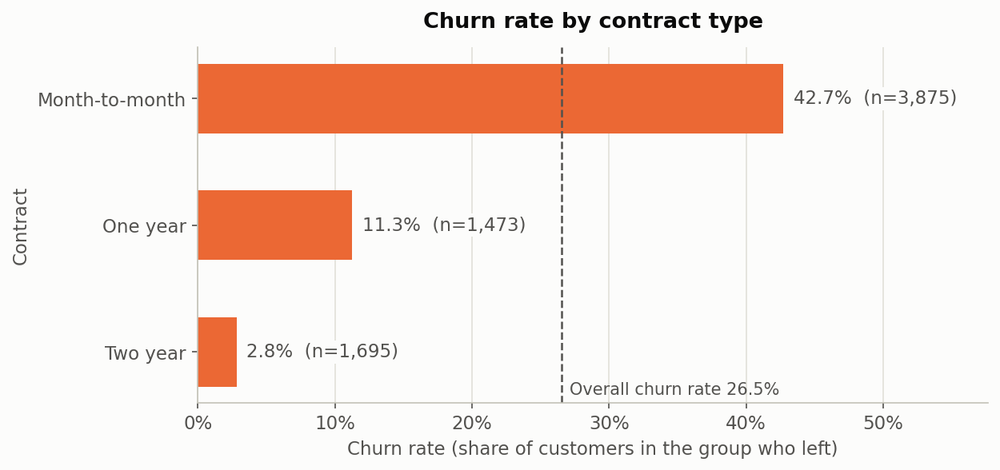

# Telco Customer Churn Prediction

**Machine Learning Classification Dashboard | M.Tech AIML – Machine Learning Assignment 2**

| | |
|---|---|
| **GitHub repository** | [github.com/KiranGaneshKorada/ml-classification-assignment-2](https://github.com/KiranGaneshKorada/ml-classification-assignment-2) |
| **Live Streamlit app** | [telco-churn-classifier-2026aj05797.streamlit.app](https://telco-churn-classifier-2026aj05797.streamlit.app/) |

---

## 1. Problem Statement

A telecom operator loses revenue every time a subscriber cancels the service ("churns"). Retaining an
existing customer is usually cheaper than acquiring a new one, so it is useful to identify customers who are
likely to leave while there is still time to act.

The goal of this project is to **predict whether a customer will churn (Yes/No)** from their account,
service-subscription and billing information. We train five different classification algorithms on the same
data, evaluate them on the same held-out test set with six metrics, and deploy an interactive Streamlit
application that evaluates and compares all five saved models on any labelled test CSV.

## 2. Dataset Description

| Property | Value |
|---|---|
| Dataset | Telco Customer Churn (IBM sample data, distributed on Kaggle: [blastchar/telco-customer-churn](https://www.kaggle.com/datasets/blastchar/telco-customer-churn)) |
| File | `data/raw/WA_Fn-UseC_-Telco-Customer-Churn.csv` (kept unmodified) |
| Instances | **7,043** customers (one row each) |
| Columns | 21 = 1 identifier (`customerID`) + **19 input features** + 1 target (`Churn`) |
| Target variable | `Churn`: whether the customer left (`Yes`) or stayed (`No`) |
| Task type | **Binary classification**, positive class = `Churn = Yes` (encoded as 1) |
| Class balance | No: 5,174 (73.46%) · Yes: 1,869 (26.54%), a moderate imbalance of about 2.8 : 1 |

The assignment requires at least 500 instances and 12 input features; the dataset has 7,043 instances and 19
input features (excluding the identifier and the target).

### Input features

| Group | Features | Type |
|---|---|---|
| Demographics | `gender`, `SeniorCitizen` (0/1), `Partner`, `Dependents` | Categorical (binary) |
| Account | `tenure` (months, 0–72) | Numerical |
| | `Contract` (Month-to-month / One year / Two year), `PaperlessBilling`, `PaymentMethod` (4 values) | Categorical |
| Services | `PhoneService`, `MultipleLines`, `InternetService` (DSL / Fiber optic / No), `OnlineSecurity`, `OnlineBackup`, `DeviceProtection`, `TechSupport`, `StreamingTV`, `StreamingMovies` | Categorical |
| Billing | `MonthlyCharges`, `TotalCharges` | Numerical |

That gives **3 numerical** and **16 categorical** features. `SeniorCitizen` is stored as 0/1 but is treated as a
categorical yes/no flag.

### Data-quality findings (from inspection of the actual CSV)

- `TotalCharges` is stored as text. **11 values are blank strings (`" "`)**. All 11 belong to customers with
  `tenure = 0` who have not been billed yet. pandas reports zero nulls because the blanks are strings, not NaN.
- No other missing values, no fully duplicated rows and no duplicate `customerID`s.
- 22 rows are identical to another row once `customerID` is ignored. These are plausible distinct customers
  with simple profiles (e.g. 1-month, phone-only plans), so they were kept.
- The values "No internet service" and "No phone service" repeat information already given by
  `InternetService = No` and `PhoneService = No`.

## 3. Data Preprocessing

All preprocessing lives in [`src/preprocessing.py`](src/preprocessing.py) and is packaged as a scikit-learn
`Pipeline`. The same pipeline is saved inside every model file and reused by the Streamlit app.

1. **Feature/target separation:** `customerID` is dropped and `Churn` is encoded as `No → 0`, `Yes → 1`
   (any other label raises an error).
2. **Cleaning step (stateless, inside the pipeline):**
   - `tenure`, `MonthlyCharges` and `TotalCharges` are converted with `pd.to_numeric(errors="coerce")`.
   - The 11 blank `TotalCharges` values are **imputed with 0**. Every one of them has `tenure = 0`, so the customer
     has not been charged yet. This is a fixed rule, not a statistic learned from the data.
   - Categorical values are cast to stripped strings, so `SeniorCitizen` is encoded consistently whether it is
     read as a number or as text.
3. **Encoding (`ColumnTransformer`):**
   - `StandardScaler` on the 3 numerical features.
   - `OneHotEncoder(handle_unknown="ignore")` on the 16 categorical features. A category not seen during training
     is encoded as all zeros instead of causing an error.
   - The result is **46 model features** (3 scaled + 43 one-hot).
4. **Train/test split:** 80/20, `stratify=y`, `random_state=42`.

   | Split | Rows | No | Yes |
   |---|---|---|---|
   | Training | 5,634 | 4,139 (73.46%) | 1,495 (26.54%) |
   | Test | 1,409 | 1,035 (73.46%) | 374 (26.54%) |

   The test rows are saved verbatim from the raw CSV (19 features + `Churn`, without `customerID`) as
   [`data/processed/test_data.csv`](data/processed/test_data.csv). Three of these rows keep their blank
   `TotalCharges`, which the pipeline handles when the file is loaded.
5. **No leakage:** the scaler and encoder are fitted only on the training rows, as the first step of each model
   pipeline. Validation confirms that every fitted scaler saw exactly 5,634 rows.

## 4. Exploratory Data Analysis

The full analysis with charts is in [`notebooks/exploratory_analysis.ipynb`](notebooks/exploratory_analysis.ipynb).
Figures are exported to [`results/eda/`](results/eda/). The analysis uses all 7,043 rows for description only;
nothing is fitted in the notebook.

| Pattern | Evidence |
|---|---|
| Class imbalance | 73.46% No / 26.54% Yes, so a model that always predicts "No" would already reach 73.5% accuracy |
| Contract length is the strongest single signal | Churn rate: month-to-month **42.7%** · one year **11.3%** · two year **2.8%** |
| Fibre-optic customers churn most | Fiber optic **41.9%** · DSL **19.0%** · no internet **7.4%** |
| Electronic-check payers churn most | Electronic check **45.3%** vs. 15.2–19.1% for mailed check, bank transfer and credit card |
| New customers are the highest risk | Median tenure of churners **10** months vs **38** for stayers. Churn rate falls from **52.9%** (0–6 months) to **9.5%** (49–72 months) |
| Higher monthly charges, more churn | Median monthly charge **$79.65** for churners vs **$64.43** for stayers. 90.9% of the 1,389 customers paying under $25 stayed |
| `TotalCharges` is largely redundant | Pearson r = **0.83** with `tenure`, **0.65** with `MonthlyCharges` |
| Tenure has the strongest linear link to churn | r = −0.35 (tenure), −0.20 (TotalCharges), +0.19 (MonthlyCharges) |

<p align="center">
  
</p>

## 5. Models Used

All five classifiers use their default settings, apart from the parameters listed below. Each is wrapped in the
same pipeline, `Pipeline([("preprocessor", build_preprocessor()), ("classifier", <model>)])`, and trained on
the identical 5,634-row training split. No hyperparameter tuning was performed; these are baseline models.

| # | ML Model Name | Configuration |
|---|---|---|
| 1 | Logistic Regression | `LogisticRegression(max_iter=2000, random_state=42)` |
| 2 | Decision Tree | `DecisionTreeClassifier(random_state=42)` |
| 3 | K-Nearest Neighbors (kNN) | `KNeighborsClassifier(n_neighbors=5)` |
| 4 | Gaussian Naive Bayes | `GaussianNB()` |
| 5 | Support Vector Machine (SVM) | `SVC(probability=True, random_state=42)` (RBF kernel) |

**Evaluation:**
- All models are scored on the same 1,409 held-out test rows.
- The positive class is `Churn = Yes`. Precision, recall and F1 use binary averaging with `zero_division=0`.
- **AUC is computed from `predict_proba()` probabilities.** The other metrics use `predict()`.
- MCC is the Matthews correlation coefficient.

### 5.1 Comparison table: evaluation metrics on the test set

| ML Model Name | Accuracy | AUC | Precision | Recall | F1 | MCC |
|---|---|---|---|---|---|---|
| **Logistic Regression** | **0.8055** | **0.8420** | **0.6572** | 0.5588 | **0.6040** | **0.4790** |
| Decision Tree | 0.7246 | 0.6509 | 0.4818 | 0.4947 | 0.4881 | 0.2999 |
| kNN | 0.7573 | 0.7882 | 0.5419 | 0.5535 | 0.5476 | 0.3818 |
| Gaussian Naive Bayes | 0.6955 | 0.8075 | 0.4597 | **0.8396** | 0.5941 | 0.4268 |
| SVM | 0.7899 | 0.7928 | 0.6373 | 0.4840 | 0.5502 | 0.4232 |

Bold marks the best value in each column. Source: [`results/model_comparison.csv`](results/model_comparison.csv).
The full classification reports are in [`results/classification_reports/`](results/classification_reports/) and a
readable summary is in [`results/metrics_summary.txt`](results/metrics_summary.txt).

### 5.2 Confusion matrices (test set: 1,035 stayed, 374 churned)

| ML Model Name | True negatives | False positives (false alarms) | False negatives (missed churners) | True positives |
|---|---|---|---|---|
| Logistic Regression | 926 | 109 | 165 | 209 |
| Decision Tree | 836 | 199 | 189 | 185 |
| kNN | 860 | 175 | 167 | 207 |
| Gaussian Naive Bayes | 666 | 369 | **60** | **314** |
| SVM | 932 | **103** | 193 | 181 |

How to read this:
- For churn, a **false negative** is a customer who leaves without being flagged.
- A **false positive** is a loyal customer who would receive an unnecessary retention offer.
- The models trade these two errors differently: SVM raises the fewest false alarms but misses the most churners,
  while Gaussian Naive Bayes misses the fewest churners at the cost of the most false alarms.

Heatmaps for each model are in [`results/confusion_matrices/`](results/confusion_matrices/).

### 5.3 Training vs. test scores

To check for overfitting, the saved pipelines were also scored on their own training split, without any
refitting ([`src/train_test_gap.py`](src/train_test_gap.py) → [`results/train_test_gap.txt`](results/train_test_gap.txt)).

| ML Model Name | Train Accuracy | Test Accuracy | Train MCC | Test MCC |
|---|---|---|---|---|
| Logistic Regression | 0.8055 | 0.8055 | 0.4763 | 0.4790 |
| Decision Tree | 0.9980 | 0.7246 | 0.9950 | 0.2999 |
| kNN | 0.8376 | 0.7573 | 0.5727 | 0.3818 |
| Gaussian Naive Bayes | 0.6965 | 0.6955 | 0.4308 | 0.4268 |
| SVM | 0.8220 | 0.7899 | 0.5128 | 0.4232 |

A large gap between training and test scores is clear evidence of overfitting. A small gap on a single split
does not prove that a model generalises well; it only means this comparison shows no overfitting.

### 5.4 Observations on each model

| ML Model Name | Observation about model performance |
|---|---|
| **Logistic Regression** | Best on five of the six metrics: accuracy 0.8055, AUC 0.8420, precision 0.6572, F1 0.6040 and MCC 0.4790. Its training and test scores are almost identical (MCC 0.4763 vs 0.4790), so this split shows no sign of overfitting. The EDA found that churn is driven mostly by a few strong, largely additive factors (contract, tenure, internet type, payment method), which suits a linear model on one-hot and scaled features. Its main weakness is recall: at the default 0.5 threshold it misses 165 of the 374 churners (recall 0.5588). |
| **Decision Tree** | Weakest model on every metric (MCC 0.2999, AUC 0.6509). With no depth limit the tree grew to depth 22 with 1,105 leaves and **clearly overfits**: training accuracy 0.9980 vs test accuracy 0.7246, and training MCC 0.9950 vs test MCC 0.2999. Because its leaves are almost pure, its predicted probabilities are close to 0 or 1, which explains the low AUC. Limiting depth or the minimum leaf size would be the obvious next step; it was not done here because these are untuned baselines. |
| **kNN** | Middle of the field (MCC 0.3818, AUC 0.7882) with balanced precision and recall (0.5419 / 0.5535). It shows a moderate train–test gap (MCC 0.5727 vs 0.3818). Distance on 46 mostly binary one-hot dimensions is a fairly coarse similarity measure, and k = 5 was not tuned. It also stores all 5,634 training rows, so it is the largest model file (about 2.1 MB). |
| **Gaussian Naive Bayes** | Has by far the **highest recall (0.8396)**: it catches 314 of 374 churners and misses only 60. The cost is 369 false alarms, giving the lowest precision (0.4597) and lowest accuracy (0.6955). Its ranking quality is still good (AUC 0.8075, second best), and it is second by MCC (0.4268). Its assumptions are only loosely met: the features are not independent (TotalCharges is strongly correlated with tenure), and Gaussian likelihoods are applied to 0/1 one-hot columns. Training and test scores are very close. |
| **SVM** | Second-highest accuracy (0.7899) and precision (0.6373), but the **lowest recall (0.4840)**: it is the most conservative model, with the fewest false alarms (103) and the most missed churners (193). AUC is 0.7928; the raw decision-function scores give the same AUC, so this is not an effect of the probability calibration. MCC 0.4232 puts it just behind Naive Bayes. The RBF kernel's default `C` and `gamma` were not tuned. |

### 5.5 Overall best model

**Logistic Regression is the overall baseline winner.** It has the highest MCC (0.4790) and is best on five of the
six metrics (accuracy, AUC, precision, F1 and MCC).

MCC is used as the main ranking metric because it uses all four cells of the confusion matrix and remains
informative under class imbalance. Accuracy can look good simply by predicting the majority class. The ranking by
MCC is:

1. Logistic Regression (0.4790)
2. Gaussian Naive Bayes (0.4268)
3. SVM (0.4232)
4. kNN (0.3818)
5. Decision Tree (0.2999)

**Gaussian Naive Bayes has the highest recall (0.8396).** If missing a churner is much more costly than
contacting a customer who would have stayed, its recall may matter more than its lower precision. The best choice
therefore depends on the relative cost of the two error types.

### 5.6 Limitations

- These are untuned baselines: default hyperparameters, the default 0.5 decision threshold and no class weighting.
- All results come from a single stratified 80/20 split. Small differences, such as Naive Bayes vs SVM on MCC
  (0.4268 vs 0.4232), may not be meaningful without cross-validation or repeated splits.
- For SVM, `predict()` uses the SVM's own decision boundary while `predict_proba()` comes from a separately fitted
  calibration, so the two can disagree for a few rows. This is standard scikit-learn behaviour; threshold-based
  metrics use `predict()`.

## 6. Streamlit Application

[`app.py`](app.py) is an interactive dashboard that **evaluates all five saved models on an uploaded, labelled
test CSV**. Every result shown in the app is calculated live from the uploaded file.

**Features:**
- **CSV upload** (`.csv` only), plus a switch to use the bundled `data/processed/test_data.csv` and a button to
  download it as a sample.
- **Input validation with clear error messages.** The app reports:
  - missing columns, by name;
  - blank or unexpected `Churn` labels;
  - non-numeric `tenure`, `MonthlyCharges` or `TotalCharges`;
  - empty, header-only or unreadable files.

  Blank `TotalCharges` values are handled by the standard preprocessing rule. Unseen category values and extra
  columns produce a warning instead of an error. `customerID` is optional.
- **Dataset overview:** file name, number of records and the actual churn distribution.
- **Model comparison:** all six metrics for all five models, with the best model by MCC (ties broken by AUC)
  highlighted and a bar chart for any chosen metric.
- **Model selector** (sidebar) with the five models. For the selected model the app shows:
  - a short explanation and its exact configuration;
  - six metric cards;
  - a confusion-matrix heatmap;
  - correct and incorrect prediction counts;
  - the per-class classification report.
- **Predictions download:** a CSV with the actual label and, for every model, the predicted label and churn
  probability.

**Technical notes:**
- Models are loaded once with `st.cache_resource`.
- Evaluation results are cached by file content, so a new upload is always re-evaluated.
- The app only calls `predict()` and `predict_proba()`; no model is ever refitted on uploaded data.
- AUC is reported as "N/A" if the uploaded file contains only one class, because it is undefined in that case.

## 7. Project Structure

```
ml-classification-assignment-2/
├── app.py                              # Streamlit dashboard (entry point)
├── requirements.txt                    # Pinned runtime dependencies
├── README.md
├── .gitignore
├── .streamlit/config.toml              # App theme and upload limit
├── inspect_dataset.py                  # Phase 1: read-only inspection of the raw CSV
├── data/
│   ├── raw/WA_Fn-UseC_-Telco-Customer-Churn.csv     # original dataset (unmodified)
│   └── processed/test_data.csv                      # held-out test set (1,409 rows, 19 features + Churn)
├── model/                              # five fitted pipelines (preprocessing + classifier)
│   ├── logistic_regression.joblib
│   ├── decision_tree.joblib
│   ├── knn.joblib
│   ├── naive_bayes.joblib
│   └── svm.joblib
├── notebooks/
│   └── exploratory_analysis.ipynb      # EDA with charts and observations
├── src/
│   ├── preprocessing.py                # cleaning, preprocessing pipeline, train/test split
│   ├── train_models.py                 # trains, evaluates and saves the five models
│   ├── evaluate_models.py              # metric, report and confusion-matrix helpers
│   ├── app_logic.py                    # app logic: model loading, CSV validation, evaluation
│   ├── train_test_gap.py               # train vs test scores of the saved models (read-only)
│   ├── validate_preprocessing.py       # Phase 2 checks
│   ├── validate_models.py              # Phase 3 checks
│   └── validate_app.py                 # Phase 4 checks
└── results/
    ├── model_comparison.csv            # 5 models x 6 metrics
    ├── metrics_summary.txt             # readable summary of all results
    ├── test_predictions.csv            # per-row predictions and probabilities for each model
    ├── train_test_gap.csv / .txt       # training vs test scores
    ├── classification_reports/         # one report per model
    ├── confusion_matrices/             # CSV + PNG per model
    ├── eda/                            # EDA figures
    └── *_validation.txt                # validation outputs for each phase
```

## 8. Installation

**Requirements:** Python **3.9–3.12**. The pinned `numpy==2.0.2` has no wheels for Python 3.13 or later. The
project was developed on Python 3.9.6 and also tested from a fresh clone on Python 3.12.

```bash
git clone https://github.com/KiranGaneshKorada/ml-classification-assignment-2.git
cd ml-classification-assignment-2

python3 -m venv .venv
source .venv/bin/activate          # Windows: .venv\Scripts\activate
pip install -r requirements.txt
```

The library versions are pinned on purpose. The saved `.joblib` pipelines are scikit-learn 1.6.1 objects, and
pickled scikit-learn models should be loaded with the same scikit-learn version they were saved with.

## 9. Running the Application

The deployed app is available at
[telco-churn-classifier-2026aj05797.streamlit.app](https://telco-churn-classifier-2026aj05797.streamlit.app/) and
needs no installation. To run it locally instead, from the project folder with the virtual environment activated:

```bash
streamlit run app.py
```

Streamlit prints a local URL (normally http://localhost:8501); open it in a browser.

### Using the app

1. **Load test data:** in the sidebar, upload a labelled CSV, or switch on **Use bundled held-out test set**.
   You can also click **Download sample test CSV** to get a file in the correct format.
2. **Check the dataset overview:** record count, churn distribution and any notes about the data, such as blank
   `TotalCharges` values or unseen categories.
3. **Compare all models:** the first tab shows the six-metric table for all five models, the best model by MCC
   and a chart for any metric.
4. **Inspect a model:** choose a classifier in the sidebar and open **Inspect selected model** to see its
   metrics, confusion matrix, prediction counts and classification report.
5. **Download predictions:** the **Predictions** tab provides a CSV with actual and predicted labels and churn
   probabilities for all five models.

**CSV format:**
- The 19 input feature columns listed in Section 2 plus `Churn` (`Yes`/`No`).
- `customerID` is optional and column order does not matter.
- The file can have any number of rows.

## 10. Reproducing the Results

All scripts are run from the project folder and use fixed random seeds.

```bash
python -m src.preprocessing           # recreate the stratified split and data/processed/test_data.csv
python -m src.train_models            # retrain the five pipelines; overwrites model/ and results/
python -m src.train_test_gap          # training vs test scores of the saved models
python -m src.validate_preprocessing  # 19 checks
python -m src.validate_models         # 53 checks
python -m src.validate_app            # 31 checks
```

Retraining is deterministic. On the development environment a second run produced byte-identical model and
result files. Re-executing the EDA notebook additionally requires Jupyter, which is not in `requirements.txt`
because the app does not need it.

## 11. Validation Summary

| Suite | Checks | What it verifies |
|---|---|---|
| `validate_preprocessing` | 19 / 19 | Original CSV unchanged; no train/test overlap; churn rate preserved in both splits; test CSV identical to the raw rows; no missing values after preprocessing; unseen categories handled; preprocessing fitted on training data only |
| `validate_models` | 53 / 53 | Configurations as specified; every model fitted only on the 5,634 training rows; all six metrics recomputed independently from the reloaded models; AUC computed from probabilities; retraining reproduces identical predictions; no hardcoded results |
| `validate_app` | 31 / 31 | App starts; all five models load; results on `test_data.csv` match Phase 3 exactly; valid and invalid uploads handled (missing columns, bad labels, blank `TotalCharges`, unseen categories, single class, different row counts); confusion matrix and report update with the selected model; no `fit()` is called while the app runs; model files unchanged |

## 12. Deployment (Streamlit Community Cloud)

The app is deployed on Streamlit Community Cloud at
[telco-churn-classifier-2026aj05797.streamlit.app](https://telco-churn-classifier-2026aj05797.streamlit.app/).

To deploy your own copy:

1. Push this repository to GitHub, including `model/*.joblib` and `data/processed/test_data.csv`.
2. On [share.streamlit.io](https://share.streamlit.io), create a new app from the repository, then choose the
   branch and set the main file path to `app.py`.
3. Under **Advanced settings**, choose **Python 3.12** (any of 3.9–3.12 works with the pinned versions).
4. Deploy.
